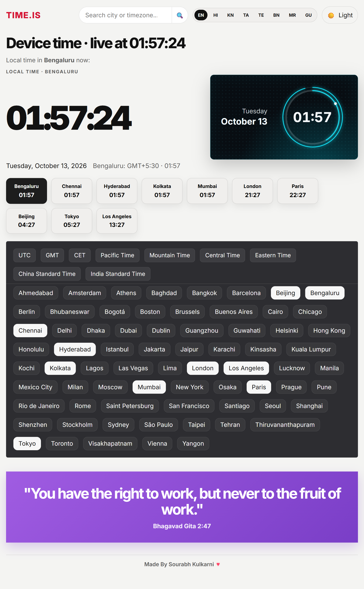

# World Clock Web Version

A responsive, static world-clock dashboard built with HTML, CSS, and vanilla JavaScript.

## Features

- Live clocks for multiple selected cities and time zones
- Bengaluru as the default location, with additional Indian cities
- Search and autocomplete for the included city and time-zone list
- Selectable UTC, GMT, CET, US, China, and India time-zone shortcuts
- English, Hindi, Kannada, Tamil, Telugu, Bengali, Marathi, and Gujarati interface labels
- Light and dark themes
- Responsive layout for phones, tablets, and desktops

## Screenshot



## Requirements

- A modern browser with `Intl.DateTimeFormat` time-zone support
- Python 3 only if you want to run a local HTTP server; no packages or API keys are required

The clock uses the device's system time and the browser's built-in time-zone data. It makes no paid API calls.

## Run Locally

From the repository root, start a local server for this folder:

```powershell
cd Web-Version
py -m http.server 8003
```

Then open [http://localhost:8003](http://localhost:8003).

Stop the server with `Ctrl+C`.

## Hosting

This is a static site and needs no build step or backend. Host the contents of this folder on any static web host. The entry point is `index.html`.

## Files

```text
Web-Version/
|-- index.html
|-- app.js
|-- styles.css
|-- screenshots/
|   `-- web-clock-updated.png
`-- README.md
```
